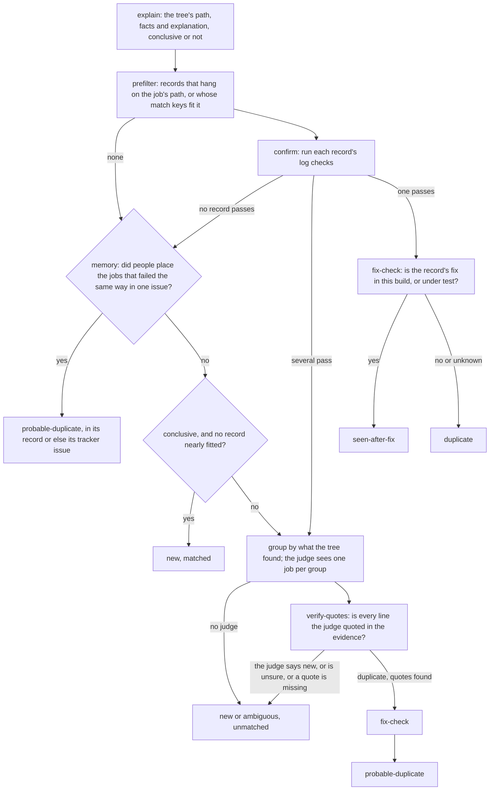

# How qa_triage works

This is how the tool decides what each failed job is, how it learns, and why it is built
the way it is. [The README](../README.md) says how to start, and [the user guide](guide.md)
every command and setting.

Most failures in a QA run are problems someone has already seen and filed. Matching
them to their trackers by hand takes reviewers hours, and asking an AI agent to
read every log is slow and expensive. This tool first explains each failure the way
a reviewer would, with a tree of questions written in Python: what went wrong first?
If a daemon crashed, which one, and on what assert? If the assert is a generic one,
which error was it, in which operation, called from where? It then looks the
explanation up in its records of known problems. Neither step uses AI, and each
says whether it matched. An AI judge is asked only about the failures they could not
match, once per distinct failure. An analyst, only if you ask for one, then
teaches the tree, adding questions or mending one that answered wrongly, as Python
code that the tool checks and tests, or adds records, so that the tool decides such
failures by itself from then on.

It is not tied to any AI agent, or to any company's. The judge and the analyst are
whatever agents you choose: the command line of a coding agent, such as Bob Shell,
Claude Code or goose, a model served by Ollama, any OpenAI-compatible API, or any
command that reads a prompt and prints an answer (see
[Agents and config](guide.md#agents-and-config)).
The tree and the records use none.

## How a job is triaged

Every failed or dead job of the run goes through these steps:



- **The tree explains first, with no AI.** Its nodes ask one question after
  another and follow the answers, as a reviewer does (see
  [The decision tree](#the-decision-tree)). Its path through them, such as
  `crash/abort/bluestore-error/error-2`, the facts it found, such as the daemon, the
  assert and the function, and what each node said, with the log lines it read, are
  the job's explanation. It is conclusive if a node could say it explains the
  failure, and inconclusive if one could not, or had to ask a question that needs
  judgement.
- **Every result cites its evidence.** Each answer of the tree, and each check of a
  record, cites the lines of the logs it was decided by, as `file:line`, such as the
  assert, the error, or the cluster log's warning. The report shows each line whole
  under the answer, with what was found in it in bold, linked to its file in the
  archive, and `qa_triage open <run>/<job> <file>:<line>` opens the file at the line
  in your own editor (`v` in the review), so that a person can check a result
  without hunting through the logs. With the archive on a host, the file is opened
  there, over ssh, where it is: nothing is copied. The `editor` setting chooses the
  editor, such as `lnav -c ':goto {line}' {file}` (default `$VISUAL`, `$EDITOR` or
  vim), and `edit_on: here` opens a copy here instead.
- **Records hang in the tree.** Each known problem is a YAML record in
  [library/problems/](../library/problems/), of its tracker issue. People do not always file one: a
  problem nobody did can have a record of the pull request that fixed it, or caused
  it, whose id is `PR` and its number, such as `PR68305`. The report shows records as
  `TR 76295` and `PR 68305`, linked to the issue or the pull request. A record says
  where in the tree it hangs (`tree`, such as `crash/abort`, or a list of paths for a
  cause that shows first as different symptoms in different jobs), with regexes over
  the facts the tree finds there (`facts`, such as the assert's message and the
  function that called it); a record not yet placed in the tree says which jobs it can
  apply to, with regexes over the job's description and failure reason from pulpito.
  Either can have confirm checks: regexes over the job's archived files, such as
  `teuthology.log`, daemon logs or the journal, searched where the archive is (see
  [Where the job files are](#where-the-job-files-are)). A record's checks look for the
  cause, not the symptom. See [CONTRIBUTING.md](../CONTRIBUTING.md).
- **Fix check.** If a record lists its fix with the merge's `git describe` (the
  tracker's "Fixed In" field), a match in a build that already contains the fix is
  escalated as `seen-after-fix`: the fix did not work, or the problem came back.
  For a test problem (`kind: test`), whose fix is in `qa/`, it is the commit of the
  qa suite the job ran that must contain the fix; it differs from the build's when
  a run tests a suite branch. The same happens when the fix is one of the PRs the
  run tests. The tool finds the
  run's QA tracker on tracker.ceph.com by its branch, and reads the PRs it lists.
- **The PRs under test.** In the ceph clone, the tool reads which PRs the run's
  testing branch merged (ptl-tool's "Merge PR #N into wip-..." and git pull's
  "Merge branch '...' of ... into wip-...", whose PR GitHub names), or, for a
  developer's own branch, the commits made on the base, and the files each changes.
  A job that
  ran one of those files, as its description, failure reason or the tree's
  explanation names it (a workunit script, a suite yaml, a source file in a
  backtrace), is listed first in the report and the drafts, as possibly caused by
  that PR, and in no list of unrelated failures, whatever record it fits: calling a
  PR's failure a known one would let it merge.
- **The base branch.** The tool reads the failures of the runs of the same suite on
  the branch the PRs were made against (main, or the release the testing branch
  names), within three weeks of the run. A job whose test failed there too, the same
  way, was not caused by the PRs under test, and the report says so beside any PR
  that changes a file it ran.
- **The machines.** A machine that failed three or more of the run's jobs, in as
  many different ways, none of them a known problem of the test or the product, is
  named in the report as possibly at fault: a bad disk or network card fails
  unrelated tests.
- **Matched, or unmatched.** A job is matched if one record's checks place it, or if the
  tree explained it conclusively and no record even nearly fitted: then it is new,
  and the explanation says what failed. Every other job is unmatched.
- **A judge, for what is unmatched.** Unmatched jobs are grouped by what the tree found
  (its path, and what tells the failure apart there, with hosts, numbers and hashes
  masked), so twenty jobs with the same failure cost one call. The judge, an AI
  agent, gets the tree's explanation and the question it could not answer, compacted
  evidence (the error lines of `teuthology.log`, one per template, and its last
  lines, without those that a job of the same run that passed, the most like it,
  logs too, as they are not what failed), the results of the candidate records'
  checks, and the candidate records. It answers `duplicate` of a known problem with
  quoted log lines, `new` with a summary of what failed and where, or `unsure`. An
  unsure judge can say what would decide it: the files of the archive it needs, such
  as a daemon's log; it is then given their error lines and last lines, and asked
  again, once. It writes for a person who has
  not read the logs: a few sentences of what failed and why it is, or is not, the
  known problem; then a walkthrough, the steps to check that for themselves, as a
  developer would take them through the logs: what to open or search for, and
  where, what they will see there and what it means, with the lines each step rests
  on, from where the job failed back to its cause, and last what to do now. It says
  where a step of the tree's was wrong; each line it quotes says what it shows. The
  report shows the steps, each with the command that opens the log at its first
  line, and under it each line of the logs that has a quote, whole, with the quote
  in bold and where it is: up to `cited_lines` (10) of them, the one the judge read
  among them, and how many there are.
- **Quotes are verified.** A `duplicate` verdict counts only if every line the judge
  quoted is in the evidence, and not every one of them is a line the job of the run
  that passed logs too; otherwise the job is escalated. (Alibaba's RCAgent filters
  an LLM's log analysis the same way.) Even then the verdict
  is `probable-duplicate`, kept apart from the checked duplicates in the report. A
  `new` verdict leaves the job unmatched: the judge knew no problem it is, which is not
  to say none is on the tracker.
- **An analyst, if you ask for one.** For the groups the tree and the records could
  not decide, the analyst finds the cause, and changes the tree, adding a node or
  mending one that answered wrongly, or changes the records, so that they decide
  jobs like them without a judge from then on; see
  [What the analyst changes in the tree](#what-the-analyst-changes-in-the-tree). For the new failures, the tool
  writes draft records, placed where the tree put them, for a person to finish
  once they have filed a tracker.

## The decision tree

The tree is the library's [nodes/](../library/nodes/) (the `nodes` setting): one
Python file for each node, from the root's, `root.py`, down.
[qa_triage/tree/](../qa_triage/tree/) is the engine that walks it: `core.py`, the
landmarks in `marks.py`, and the helpers nodes share in `common.py`. Each node is a
function, registered at a path, that asks one question and answers it with one of:

- `go(branch, ...)`: the answer; the node at `<path>/<branch>` asks the next question.
- `done(branch, ...)`: the answer, which explains the failure: conclusive.
- `judge(question, ..., branch=...)`: the logs hold the answer, but finding it needs
  judgement: inconclusive, and the judge is asked that question.
- `unknown(..., branch=...)`: no answer that this node knows: inconclusive.

Each answer says in a sentence what the node found, with the log lines it read, and
can add facts for the nodes after it and for records. Every answer but `unknown`
cites the lines it was decided by: people are shown them as its evidence, the checks
of an analyst's answer refuse a node it adds or changes that decides without citing a
line, and `qa_triage verify` checks the nodes' examples for it. The root asks
what went wrong first: a daemon that crashed before teuthology saw the job fail
explains the failure, whatever teuthology reported, so crashes come before everything
but the test infrastructure. Tests that crash daemons on purpose, such as
`rados/test_crash.sh`, are known, and their crashes are not taken for the cause.

Nodes read the landmarks: the lines of `teuthology.log` that one pass over it finds
for all of them, such as task starts and failures, exceptions, daemons' asserts,
signals and backtraces (the ceph task copies each daemon's stderr into
`teuthology.log`), coredumps, and the commands run. On the archive host grep picks
out the candidate lines first, so the pass reads a 139 MB log in about 2 seconds.
A node can also search other files when its question needs them, such as the log
of the daemon that crashed.

The tree asks now:

| Path | Question |
|---|---|
| (root) | What went wrong first: the test infrastructure, a crash, valgrind, the cluster log, a hang, a workunit, a test, a timeout or a command? |
| `infra` | Which part: the build is not on shaman, the container image, packages, ansible, ssh, the machines? |
| `crash` | Which process crashed, and how: a failed assert, an abort, a signal, or a client program? |
| `crash/abort` | Is the abort a generic one, which needs more evidence? |
| `crash/abort/bluestore-error` | Which error did BlueStore not handle, in which operation, called from where? |
| `crash/signal`, `crash/client` | Where did the daemon crash; what did the program print last? |
| `valgrind`, `cluster-log` | Which error, in which daemon; which health check or message? |
| `hung` | What was the job doing when it was killed: which test was it waiting for, or which command did it run last? |
| `workunit` | Which test failed, on what: a qa/standalone `TEST_` function and its check, a gtest, or the last command of a `set -e` script that printed an error? |
| `test`, `timeout`, `command` | Which test and assertion; what the job waited for, and what stopped it; which command, and its error? |

For example, for a job that pulpito says failed because `ceph osd dump` timed out:

```
1. What went wrong first? crash: osd.2 crashed at 17:14:27, before the job failed
2. Which process crashed, and how? abort: osd.2 on trial063 at 17:14:27:
   ceph_abort_msg("unexpected error") at os/bluestore/BlueStore.cc:16786 in
   void BlueStore::_txc_add_transaction(TransContext*, ObjectStore::Transaction*)
3. Is the abort a generic one, which needs more evidence? bluestore-error
4. Which error did BlueStore not handle, in which operation, from where? error-2:
   BlueStore did not handle error 2 (No such file or directory) in OP_SETATTRS of
   1#3:0d9e85f4:::trial14933060-992:99#, from ECLegacy::ECBackendL::handle_sub_write
   remote/trial063/log/ceph-osd.2.log.gz:589262: ... _txc_add_transaction error (2)
   No such file or directory not handled on operation 15 (op 0, counting from 0)
Conclusive: crash/abort/bluestore-error/error-2.
```

CONTRIBUTING.md says how to add a node.

The tree also grows where it stopped at a symptom: a node at the path of a
conclusive answer, such as `cluster-log/message`, is asked after it, and can explain
the cause with another conclusive answer, or leave the explanation as it was.

The tree grows where it is inconclusive. An inconclusive answer that names a branch, such as
`judge(..., branch='command')` at `hung`, leads on to the node at that path if
there is one, and the explanation says where none is yet: `No node at
"hung/command" answers it yet.` A node there is asked next, for every job that
reaches it. A person or an analyst may add a node, or change any node, the root's
too; the tool checks an analyst's change before it keeps it (see
[What the analyst changes in the tree](#what-the-analyst-changes-in-the-tree)), and
loads the files at every start. Each file lists the jobs it was written or checked
for, and the path each takes:

```python
from qa_triage.tree.core import done, node, unknown

EXAMPLES = {'<run>/<job>': 'workunit/unexplained/<cause>'}

@node('workunit/unexplained', 'Why did the workunit fail?')
def workunit_unexplained(ctx):
    found = ctx.search('teuthology.log', r'<a line that shows the cause>', '<literal>')
    if found:
        return done('<cause>', '<what failed, and why>', found[0], key='<cause>')
    return unknown('none of the failures this node knows')
```

## Where the job files are

By default the tool reads a job's files where they are: over ssh, on a sepia host
that has the teuthology archive, which needs the sepia VPN. The `archive` setting
names the host, as your ssh config names it, and the directory the runs are in
there: `trial200:/a` unless you set another. Every command that reads job files first
checks that the host answers, and says what it waits for if that is slow, so without
the VPN it stops in seconds and says so. The tool runs a small program there,
[archive_host.py](../qa_triage/archive_host.py), with the host's own `python3`; it lists
a job's files, searches them in place, several at a time, and sends back only the
lines it finds. Only `teuthology.log`, which the evidence copies, and files that an
analyst asks for whole cross the network. Searching the four OSD logs of one job,
505 MB compressed, took 14 seconds this way.

To download the files from qa-proxy instead, ask for it: `--https`, or set
`archive: https`. Another server's copy of the runs is named by its URL, as in
`--archive https://host/teuthology`; another host that has the archive, as in
`--archive host:/a`. Files are then fetched only when a check needs them, each
once, and kept in the cache (`$QA_TRIAGE_CACHE`, by default `~/.cache/qa_triage`):
up to 64 MB as they are, and bigger ones gzipped, as a `teuthology.log` of 400 MB
that the archive has not gzipped yet is kept in 32 MB. A bigger file that is
gzipped already, such as a daemon's log of a GB, is streamed again for every search
that reads it, rather than filling the cache. This is much slower: the triage says
so as it starts, and its status line while it works. If the host cannot be
reached, the tool stops as it starts, and says why, with what ssh said: it never
falls back to downloading by itself, and neither does the setup. (Earlier versions
of the setup chose https by themselves when the host did not answer; if your config
says `archive: https` and the host answers, the triage says so as it starts.)

What the host answers about a job is kept in the cache too
(`<run>/<job>/archive.json`), since a job's files do not change once it has ended,
and not asked again: starting a review of a run again, or checking a change
against the runs triaged before, asks the host only what the records and the tree
have not asked before. The run says how many questions it asked and how many were
answered from the cache.

## Learning, when asked

When a run has a judge and an analyst (`--analyst`, or `analyst` in a config file),
the analyst looks, after the judge, at the groups of jobs that the tree and the
records could not decide by themselves: the judge had to be asked, whether it was
sure or not. There is no analyst unless one is asked for, and nothing is learned
from the jobs that the tree and the records matched. For each group the
analyst, an agent that can read the evidence, the whole archive and the tree's
code, gets one job of the group, the tree's explanation, where the tree stopped,
and what the judge said about it:

- if the judge leaned towards a known problem, the analyst checks that, and changes
  that problem's record so that its checks place the job;
- if the judge called it new, it writes a node for the tree where the tree stopped,
  which finds the lines that show the cause and explains the failure conclusively,
  so that jobs like it are matched as new, with no judge; and it searches
  tracker.ceph.com, and writes a record too if an issue there describes the failure;
- if the tree explained it conclusively and no record placed it, it is new, and
  nobody has looked for its cause: the analyst debugs it, beyond the symptom where
  the tree stopped, searches the tracker, and writes a record if an issue describes
  it, or says what a person should file; it can teach the tree the cause, with a node
  below the tree's answer. What it finds goes into the report and the draft comment.
  The test infrastructure's failures are left out;
- if the checks of several records matched, it decides which is right, and makes
  their checks tell the jobs apart.

Nothing is paid for twice. Each lesson keeps what it came to, its cost and the
analyst's session, in `learn/<job>/lesson.json`, and a later run (with `--out` in
the same directory) does not teach the same failure again: it says what the lesson
came to, and leaves the group to a person. Only a lesson whose analyst stopped
without answering, such as one that ran out of turns, is resumed: once, in its own
session, asking only for its answer from what it read. `--relearn` teaches again.
A lesson stopped before it could write `lesson.json`, by a crash or by stopping the
run, is found by what it left. The judge's verdicts are kept too, in the cache, by
the evidence the judge was given: for the same evidence it is not asked again.

### What the analyst changes in the tree

The whole tree is the library's `nodes/`, one file for each node, and the analyst
may change any of it, as a person may:

- add a node where the tree stopped: at an inconclusive answer that no node follows
  yet (`No node at "hung/command" answers it yet.`), or below a conclusive answer
  that stopped at a symptom, to explain the cause;
- mend a node that answered the job wrongly, the root's too, where the lines show
  it clearly: one that took a crash after the failure for its cause, say, or sent
  the job down a branch that what people said of it shows is wrong. It changes that
  node's file, rather than adding a node below the wrong answer;
- extend a node, to tell one more failure apart at the same point;
- reword the sentence of any node's answer, in `nodes/wording.yaml`: this changes
  how the answer reads, never where a job goes.

A change to a node is held to more than a new record is, since every job that
reaches the node takes it. Besides the checks every change passes (see
[Checking a change](#checking-a-change)):

- the file keeps every example it had, each with its path: only the doubted job's
  own may change;
- every example of every file the change could reach still takes its path,
  conclusively, and a job that no one settled, which the tree explained
  differently before, may not move;
- the tool's tests ([tests/](../tests/), about a minute) pass, run on the tree as the
  change leaves it. A test that expects what the analyst found wrong refuses the
  change: the analyst names it in its suggestions for the tool, kept in the
  lesson's `analysis.md`, for the test to be changed.

[qa_triage/tree/](../qa_triage/tree/) holds only the engine, which the analyst reads
and does not change. A change to what a node already does is an edit: it is asked
about even with `approve: always`, unless `approve_edits: always` (see
[The shared library](#the-shared-library)). Once kept, it is pushed to the library,
and everyone's runs ask it from then on.

The analyst starts where the tree stopped: its prompt says how far the tree got,
every step the tree took with the lines it read, the question it could not answer,
and why the analyst is asked.

Its changes are kept only if they pass the checks described below, which use no AI:
in particular, the tree and the records must then decide the job without a judge,
the changes must not change the answer for any job settled before, and must not make
a record or a node claim any job, in this run or earlier ones, that failed in a
different way. Then the run is triaged again with the changed tree and records, so
the report shows what they now decide by themselves, and the report lists what was
learned.

## Checking a change

Whenever the analyst answers a doubt or a lesson, the tool checks its answer,
without any AI:

- every line the analyst quotes must be in the evidence;
- a node file may import only `re` and the tree's engine (`qa_triage.tree.core`,
  `common` and `marks`), and may not use
  the names and attributes that reach files, processes or the interpreter, such as
  `open`, `eval`, `getattr` or any that start with `_`; it runs with only a few
  builtins, and it must load, and register a node at a path no other file has;
- with the changes, the doubted job must get the analyst's answer; when a run
  learns, the tree and the records must decide it without a judge;
- a changed node file keeps every example it had, with its path, but the doubted
  job's; and the tool's tests pass on the tree as the change leaves it;
- every example of a record or of a node file, and every job settled before,
  that a change could apply to must still get its own answer, or take its path
  conclusively;
- every other job triaged before (the `results.json` of earlier runs, see
  `--corpus`) whose result the change would alter must have failed the same way as
  the doubted job or one of the examples of what changed: the same failure reason,
  with hosts, numbers and ids masked, or, for a node, the same explanation before
  it. A node must also not make sure a job that a judge placed in a known problem.
  This keeps a record or a node from quietly claiming jobs that failed for other
  reasons, which no settled job may cover yet;
- a new record's tracker must be a problem, not a QA batch, a backport or an issue
  closed as a duplicate;
- a new record must name its tracker's fix with the version it was merged in, if
  the tracker gives one, so that the fix check can escalate later sightings;
- a record's new or changed confirm checks are tried on up to ten jobs of the same
  runs that passed, those whose descriptions are like its own first: checks that
  all find their lines in more than one in ten of them find what any job logs, not
  the failure, as OpenStack's elastic-recheck held its queries to the same;
- with runs held out of learning (the `holdout` setting, see [Learning from what
  people decided](#learning-from-what-people-decided)), the change may not place
  fewer of their jobs as people did; the analyst is told only how many it could
  change, and how many were right before and after, never which or what they are.

The checks read the logs of each job they try: of the jobs the change could reach,
to triage them with it, and of the examples of the nodes it could move. Which
jobs it could reach, they read from `paths/` in the library, where the tree took each
settled job and each example when it was last walked, or else from the earlier
triages; a job neither gives is walked through the tree first, which reads its logs.
Each lesson keeps the paths of the jobs it walked with its change, and
`qa_triage paths` walks them all again, as after a change to the tree's engine.
Each file of paths, and each triage's results.json, says which code of the tree
found them (a digest of its modules): a path that other code found is not trusted,
but walked again, and the checks say so; `qa_triage lint` says how many runs' paths
other code found.
The walks go eight at a time, as the triage's do. The lower pane says how far the
checks have got ("checks: 120 of 540 ..."), and `x` stops them as it stops the
analyst; over https, where every log read is downloaded, they say that is slow.

If a check fails, the analyst is told which and asked again, up to three times.
Once the checks pass, the changed records are written to `problems/`, the changed
nodes to `nodes/`, and the job is settled: its answer is added to `labels/`, so that
every later change is checked against it too. A record says who learned it, and
each change since, in its `learned` list (the day, the analyst, the job, and who
doubted it); a node file, in its `# learned:` comments. That is how the tree and the records
learn. Nothing is committed: the changes are left in the working tree for a person
to review.

## Learning from what people decided

What people wrote about a failure is the answer the tool learns most from: one
answer, one lesson.

- `qa_triage answers` reads the RADOS team's wiki of reviewed runs
  (https://tracker.ceph.com/projects/rados/wiki/MAIN), which places each failed job
  of a reviewed run in a tracker issue, finds each section's runs from its QA
  tracker, and writes each run's answers to `answers/<run>.yaml` in the cache, as
  job id: issue. `qa_triage run <run> --known <that file> --analyst <agent>` then
  learns first from the jobs the tool placed differently: the analyst finds out who
  is right, and if it is the people, changes the records or teaches the tree; if
  it is the tool, it says why, for a person to decide. On 26 October 2026 the wiki
  had answers for 1,982 jobs of 104 runs; 65 runs were still in the archive.
- `qa_triage answers --tracker` reads the tracker instead: people link the jobs a
  problem failed in its issue, as examples of it, so each job an issue of the
  projects given (`--projects`, updated since `--since`) links to is placed in it,
  or in the issue it duplicates or backports; a line that says the job passed is
  left out, and so is a job two problems claim, and every job of an issue a bot
  files about a test machine whose last jobs failed (which lists the jobs that ran
  there, not why each failed). The answers are written as the wiki's are, to
  `answers-tracker/` in the cache.
- `qa_triage score --answers <dir>` compares the runs triaged before with those
  answers: how many jobs the tree and the records placed as people did, and how
  many against the answers as the wiki and the tracker gave them, before people
  settled some otherwise (`settle`); what decided the jobs, the records, the memory,
  the tree or the judge, and how many were decided without AI; how many jobs of
  each suite were placed rightly, and how many of those it matched; which
  records' checks matched the same jobs; which records people disagree with most,
  the commonest disagreements, and the problems the tool did not know. A record's `also` names other issues people place the same
  failures in, such as an older issue for the same cause: a job placed in the
  record is then right for them too, and is not taught again.
- `qa_triage remember --answers <dir>` writes the library's memory, `memory/`: for
  each run triaged with answers, each way a job failed (the tree's path and what
  told it apart, or else its failure reason, with hosts and numbers masked) and the
  issues people placed those jobs in, with each issue's title. A job no record
  places then takes the issue the memory agrees on (two answers or more, nine in ten
  of them alike; three for a failure reason alone) as a probable duplicate, with no
  judge: in its record, or, while no record names the issue, in the tracker issue
  itself, which `score` counts and `teach` still teaches, after the mistakes, since
  a record places such jobs the first time they fail. A run is given only the
  answers for runs scheduled before it, as when it was new, so that triaging an
  older run again does not answer it from what was learned after it; and an answer
  counts for half as much every 180 days, so that where people placed a failure in
  one issue and later in another, the later wins. The memory is kept as the version
  of how its signatures are made that made it: when that changes, the memory kept
  the old way is left out until `remember` writes it again. `remember` also writes
  `precision.yaml` beside the memory: for each problem, how often the jobs people
  answered that the tool placed in it were placed rightly, which the review and the
  report show beside each result, as "right 24 of the 38 times people answered".
- The `holdout` setting names answered runs, kept as `qa_triage answers` keeps them,
  that are held out of learning: `teach` teaches no lesson from them, `remember`
  does not remember them, and a change that would place fewer of their jobs as
  people did is not kept. `score --answers` on them is then how the library does on
  runs it has not learned from, which scores of the runs it learned from overstate.
- `qa_triage teach --answers <dir>` teaches those mistakes, the commonest first: one
  lesson for each kind, on one of its jobs, with the people's answer. The lesson's
  change is checked against every job triaged before, so one lesson teaches all
  the jobs of its kind, and the jobs that failed the same way move with it, unless
  a person, not an agent, settled them otherwise. Triaging the runs again, with no
  AI, and scoring them shows what it learned; repeated, this is how the library
  learns from what everyone decided, and each lesson saves a judge's call on every
  later job like it.
- `qa_triage settle <job> <id> --why ... --unconfirmed` settles a job for a person,
  as an assistant would, until one confirms it by settling it again; `pending`
  lists such jobs, and `score` says how far the answers people settled moved from
  those the wiki and the tracker gave.
- `qa_triage stale` lists the records that may have had their day: their tracker
  issue closed, or their PR merged, and no job placed in the last `--days` days
  (90); an issue that duplicates another; or a record that never placed a job, and
  has no example. A person retires each, or keeps it to catch the problem if it
  comes back; a problem seen again after its fix says to reopen its issue with the
  jobs if the cause is the same, and else to file a new one.
- `qa_triage outcomes` lists the records whose tracker issues people have written
  on since they were last checked: comments, a fix, pull requests. With `--learn`,
  the analyst gets the issue, its comments and its pull requests, with the files and
  functions each changed, beside the record and one of its jobs, and brings the
  record in line with what the people found: the cause, not only the symptom; the
  fix, for the fix check; the issue a duplicate belongs to. An issue the analyst
  asks for in a lesson or a doubt comes with its comments and pull requests too.

Reading the wiki needs the tracker key, and pull requests are read best with a
GitHub sign-in (see [Keys](guide.md#keys)).

To see how often the judge would catch what the tree and the records get wrong,
`qa_triage run <run> --known <file> --check` asks it to check every group they
decided, as `judge all` does, and the report counts the wrong answers it caught and
the right ones it doubted. `--check blind` does not tell the judge what they
decided, so that it decides each job afresh, and cannot simply agree.

## The shared library

What the tool learns, the problem records, the tree's questions, the
settled jobs, and the scripts people wrote to pull debug data out of logs, is a
library: a directory with `problems/`, `nodes/`, `labels/` and `scripts/`. Ceph's is
`library/` in this repository, beside the tool. The `db` setting names a library, as
a directory or a git repository's URL; a URL is cloned into the cache and updated
when qa_triage starts, and its parts are used unless the `problems`, `nodes` and
`labels` settings name others. By default, unless they do, it is `library/` on the
main branch of the repository qa_triage was cloned from: a clone of only that
directory, in the cache, which what is learned is pushed from, so that nothing in
the checkout you run is pushed with it. `db: none` uses the library of the
checkout as it is, and pushes nothing. `qa_triage share` commits what
has changed in it, pushes the commit as a branch of its own, and, for a repository on
GitHub, proposes it as a pull request, for someone to review before everyone has it;
the change is used here meanwhile. It asks first, unless given `--yes`.

A URL may end in `#branch`, for one branch of the repository, or `#branch:directory`,
for a library kept in a directory of a branch, as this repository keeps it. Only
that directory is fetched, and what is learned is pushed to that branch, code or
not: those who may push to it are trusted with what runs on everyone's machine.

This repository is private: its owner adds people as collaborators, who may then
read it and push to it.

Since many people's runs change the library, a change is made to what everyone has,
and with the person's say:

1. Before the analyst starts on a doubt or a lesson, the library is brought up to
   date with its remote (`git pull --rebase`, any change in progress set aside and
   put back), so that it works on what everyone has.
2. The analyst's change is checked as always; just before it is written, the
   library is brought up to date again, and if it moved, the change is checked
   again against what is there now. A change that rewrites a record or a learned
   node that someone else changed since the analyst was given it would undo theirs:
   the analyst is told so, given the library as it now is, and makes its change
   again on it. So is one for a job that someone else settled meanwhile, as another
   answer: theirs is not written over.
3. The person is asked, with `approve: ask` (the default): the tool shows what was
   wrong (what the tool said, what the analyst says, and why, in its words), each
   record or node it would change, as a diff, and which jobs triaged before
   would change their result. They can keep it, refuse it, see the whole diff, or
   talk it over with the analyst in its own program (Bob Shell or Claude Code, on
   the lesson's own session); a revised change it writes there is checked, and
   shown, before they decide. An answer that only settles the job, changing no
   record or node, asks no one.
4. Kept, the change is committed and pushed to the library at once, but only onto
   the library it was checked against: if someone pushed in the seconds between,
   git would merge the two changes, and no one checked them together. Instead the
   commit is taken back, the tool says what they pushed, and the change is checked
   again with theirs (step 2), up to three times. If the remote does not take the
   push, as where the person may not write to it, it is proposed as a pull request
   instead.

qa_triage processes on one machine share the library's clone: they take turns at it,
by a lock file in the temporary directory, while one brings it up to date, checks a
change or writes one, and say when they wait for another.

Where no one can be asked (no terminal, or the review's full screen, which cannot
stop in the middle of a lesson), or with `approve: hold`, each change waits, as a
commit too, on the library's HEAD, kept by a ref under `refs/qa-triage/pending/`
without touching its checkout, for you to inspect with `git show`. On the review's
full screen, a box asks about each lesson's change as soon as the lesson is done, and
about those that already wait as the review opens:
what failed, as the analyst found it, what the change does, and the commit; keep it
and it is made again onto the library as it is now, checked again, and pushed; reject
it and it is set aside in `pending/rejected/`. A change keeps the files it was made
on: if others changed them since, approving it merges the two, as a rebase would. A
record keeps the examples and `also` issues either side added, and takes any other
key from the side that changed it; a node's code is merged as `git merge-file` merges
it. If both sides changed the same key, or the merged change fails a check, it still
waits, the screen shows why, and `revise N` asks the analyst, in the session it made
the change in, to make it again for the library as it is now: that costs AI, and its
revision waits for approval in place of the old. If the library already places the
job as the change would, the screen says it may not be needed any more, and offers to
reject it first. `A` asks about every change that waits, and
the line above the keys says how many do; at the review's prompt, `pending`,
`change N`, `approve N`, `revise N` and `reject N` do the same. Outside the review,
`qa_triage pending` lists them, with their commits, and
`qa_triage doubt <job> --proposal <file>` checks one again, shows it and asks. `approve: always` keeps every change that passes the
checks without asking, for unattended training: every change that only adds to the
library, a new record or node file, or jobs added to a record's examples or
`also`. A change that edits what is there, a record's checks or tree, a learned
file's code or a sentence of the wording, is still asked about, and where no one
can be asked it waits in `pending/edits/`, unless `approve_edits: always` keeps
edits too. An addition that passes the checks adds what the library knows; an edit
can lose some of it in ways the checks cannot see, as an agent that rewrites what
it was given tends to leave it vaguer.

When the analyst's answer passes the checks but is not what people said, as when a
reviewer's answer was a slip, no one keeps its change until a person decides. The
change is kept in `pending/disputed/`, which `qa_triage pending` lists too: a
person who agrees with the analyst keeps it with `qa_triage settle <job> <id> --why
...`, which checks it again, and the lesson is not paid for twice.

A script is a directory in `scripts/` with its program and `script.yaml`:

```yaml
about: EC write transactions that were submitted and never finished, by object
run: find_hung_io                  # the program, which gets the files as arguments
files: remote/*/log/ceph-osd.*.log.gz
pattern: 'submit_transaction.*hoid: |finish_rmw.*on_all_commit on Op\('   # optional
args: '--oid OID'                  # optional: what the analyst may add
```

A lesson or a doubt lists the library's scripts in `scripts.txt`, and the analyst
can ask for one to be run on the job. Its files are copied from the archive, only
the lines the pattern finds if it has one, which the archive's host finds, and the
program runs here, on the copies, never on that host.

## The judge and the analyst

AI agents have two jobs here, which suit different models:

- The **judge** looks at the jobs the tree and the records left unmatched, once per
  group. A cheap model does: it answers from the tree's explanation and compacted
  evidence in its prompt, and its quotes are checked. Several agents can be given,
  each asked only when the one before is unsure, so the cheapest goes first. Its
  evidence also has, when there are any, the PRs under test that the job's branch
  merged, with the diffs of the files the job's logs mention, since a PR under
  test can fail a job in a way that looks like a known problem; and the tracker
  issues that a search for the job's tests finds, with or without a record, since
  the right answer may be an issue nobody has made a record of yet. A model's size
  matters less than this evidence: on 27 October 2026, three judges, from a small
  model to a large one, all agreed with the same two wrong answers that the
  evidence then lacked what was needed to catch.
- The **analyst** learns from the groups the tree and the records could not decide,
  and answers doubts. It reads the evidence and the archive itself, and writes
  nodes and records that the checks must accept, so it should be a strong model. A
  run has one only if it is asked for; `doubt` uses the config's analyst, or else
  the last of the judge's agents. It is given the PRs under test too, with the diffs
  of qa/ and of the files the failure names, and the ceph source the job ran, and
  first decides whether one of them caused the failure. If one did, it names the PR,
  quoting the diff and the log line it explains; the checks hold it to a PR the
  branch merged, and keep the job out of every record, since the failure is the
  PR's to fix, not a known problem. The report and the drafts then list the jobs
  first, as caused by that PR, in the analyst's words.
  It is given the judge's account of the job, and writes its own walkthrough, as
  the judge does, to be better than the judge's: once its answer passes the
  checks, the report and the review show its account in place of the judge's. It
  also makes the tree's own steps read well: where a node's sentence on the job's
  path is terse or unclear, it rewrites it, in the code of a node it changes, or,
  for any node, in the library's `nodes/wording.yaml`, as a sentence with the facts the
  tree found, such as `{daemon}` (checked against the job). Wording changes only
  how an answer reads, never where a job goes; it is data, so it is shared as the
  records are, not proposed for review as code is.

An agent judges in one turn with no tools. One that reads the files (the analyst
always does; for a judge, add `+files` to its spec or `files: true` to its config)
can read the whole `teuthology.log` and anything else the tool has fetched. Claude
Code and Bob Shell use their own read tools; for the others qa_triage provides its
own (`list_files`, `read_file` and `grep` over the evidence directory): it runs them
itself for `ollama` and `openai`, and serves them to goose over MCP
(`qa_triage mcp <directory>`). For an `ollama` agent, qa_triage keeps each tool
result to a tenth of its `context`, and drops earlier ones (repeated calls first,
then the biggest) when the conversation nears it; a model that can think, such as
Gemma 4, is told not to unless its config sets `think`, because thinking fills the
same context. Agents that resume sessions (Bob Shell, Claude Code, and the chat
providers) continue one conversation over a doubt's turns; for the others, the
conversation so far is repeated in each prompt.

## Safety

Teuthology logs are text written by other people and programs, so the agents are
told to treat them as data, and are limited in what they can do:

- Judges that do not read files get no tools; Claude Code is run with `--tools ""`,
  and Bob Shell with every tool group that reads or acts disabled.
- Agents that read files can only read: Claude Code gets `Read`, `Grep` and `Glob`,
  and Bob Shell only its read tools. Bob Shell approves its own tool calls in
  headless mode, so this is the only limit on it. goose gets none of its own
  extensions, and the chat providers no tools of their own: both get only
  qa_triage's, which cannot read outside the evidence directory.
- The agents never reach the network: when the analyst needs more of the archive or
  a tracker search, it asks, and qa_triage fetches it.
- A node the analyst writes is code that runs on your machine, written from logs
  that anyone can write to. The tool checks it before running it, and runs it with
  few builtins (see [Checking a change](#checking-a-change)); that keeps
  mistakes out, not a determined attacker, so read `nodes/` as you would any code
  before you commit it.
- The tool posts nothing unless you ask, and asks first: `file` and `track` write to
  the tracker with your key, and `share` pushes to the library and proposes a pull
  request. pulpito and qa-proxy are read anonymously, the tracker with your key if
  you gave one, and GitHub through `gh` or your token (see [Keys](guide.md#keys)); the
  archive host is reached with your own ssh access, and the only program run there,
  archive_host.py, reads and never writes.

## Results so far

This is an experiment. On 25 October 2026, 13 RADOS runs were waiting for review,
with 385 failed or dead jobs. With no AI, the records placed 138 of them, as they
did before there was a tree, and the tree explained 209 more conclusively as new
failures: 162 jobs that the test infrastructure failed (most of them a build that
was not on shaman, or its container image), and 47 others, 29 distinct failures,
such as an OSD's `ceph_abort_msg("out of order op")` in `PrimaryLogPG::execute_ctx`. That left
38 jobs, in 29 groups, for a judge; before the tree, the same runs needed a judge
for 68 groups, and then the analyst for up to 5 of them per run. The 13 runs took 10
minutes. On the run with the most unmatched jobs, a local Gemma 4 judged its 8 unmatched
jobs in 5 calls.

Then an analyst learned from two of those runs: from the 9 groups that the judge had
been needed for, whether it was sure or not. It settled 5. The judge had called each
of them new; the analyst found the known tracker for 4 of them (54360, 74004, 74524
and 79445), and wrote a record for each, and taught the tree answers such as
`workunit/unexplained/iscsi-gwcli-host-not-found`. Its other 4 sessions ran out of
turns before they answered, and cost more than half of what the learning did. The
same two runs were then triaged again, exactly as before: the judge was needed for
the 4 groups left, and the 4 lessons were not started again but resumed, each asked
only for its answer, for a fifteenth of what they had cost; each taught the tree an
answer. Triaged a third time, the two runs were decided by the tree and the records
alone, at no cost. Over the 13 runs, with no AI, the tree and the records now decide
374 of the 385 jobs, 27 more than before: one learned answer alone decided 12 jobs in
7 runs. None of the jobs decided before changed result, and 9 groups are left for a
judge, from 29.

Before the tree: The first records come from a RADOS QA run of October 2026,
where they placed 11 of its 21 failures with log checks alone. Checked against the
summaries that QA reviewers wrote on the RADOS QA wiki for 19 batches (22 runs,
September and October 2026), they placed 119 of the 120 jobs that the reviewers had
labelled with one of their trackers, and gave none the wrong tracker. Most of the
other failures are known problems that have no record yet. In a first test of
`doubt`, the analyst was given one job that the reviewers had labelled with a
tracker that had no record. The record it wrote placed all 18 failed jobs of those
22 runs that failed in the same test with the same error, among them the 10 other
jobs the reviewers gave that tracker.

## Prior art

Prior art this follows:
- OpenStack's elastic-recheck, with one query file per known bug, matched against CI logs.
- Chromium's LUCI Analysis, which clusters failures by normalised failure reason and
  links clusters to bugs through rules.
- Log template miners such as Drain, which mask a line's variables.
- Recent work on LLM triage that clusters failures first and asks the model about one
  representative of each cluster.
- Alibaba's RCAgent, which discards an LLM's log analysis whose evidence is not in the
  log; ByteDance's LogSage, Datadog and SAP, which give the model only the lines that
  passing runs do not log.
- syzbot, which tracks whether a bug's fix is in each build; ReportPortal, which
  places failures by the decisions people made about failures like them.
- OpsHarness, which keeps a lesson only if it does no worse on held-out cases whose
  answers the agent is not shown; and the regression-free model updates of machine
  learning, where a new model may not get wrong what the old one got right.

Where it differs, as far as a survey of those and others found by October 2026: the
analyst's lessons become deterministic records and tree nodes that later runs use
with no AI, kept only if no job of every earlier run people answered loses its
answer, and with a person's say, and shared in a library everyone's runs use. The
measure of that is how much is decided without AI, which `score` reports, and how
it does on runs held out of learning, which `holdout` keeps apart.

## Next steps

- Add records for the known problems that reviewers see most often and that have
  no record yet, placed in the tree.
- Teach the tree more answers where it stops inconclusive most often: hangs, slow ops,
  and workunits that are not standalone scripts.
- Search tracker.ceph.com for the new failures that the tree explains, with the
  facts it found, so that a reviewer sees the likely issue without a judge.
- Hold out of learning every answered run from now on, and report its score beside
  that of the runs learned from, which overstates how the library does.
- Use a small local embedding model to choose the candidate records for the judge.
